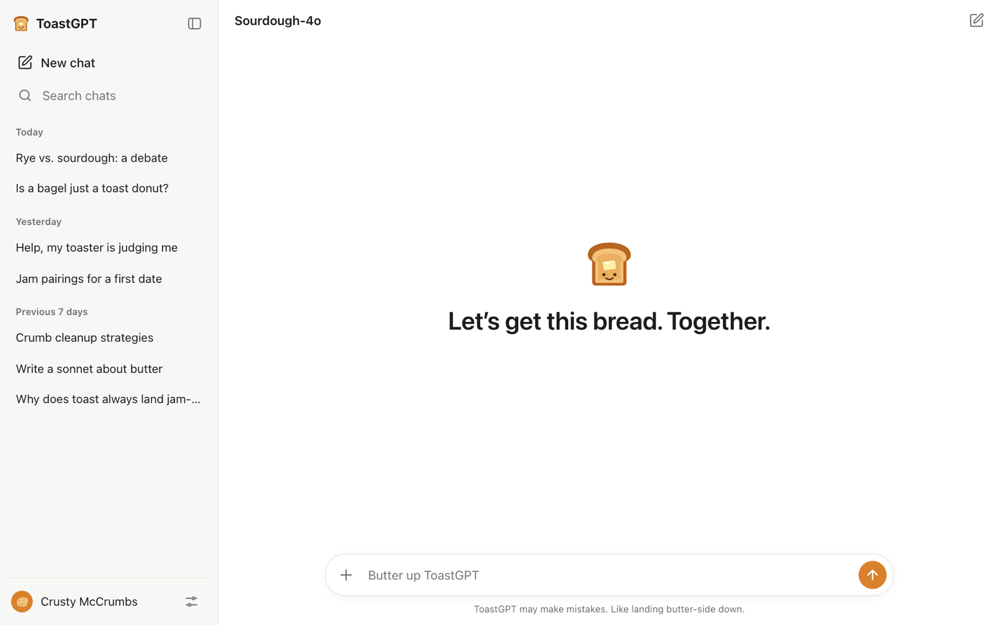
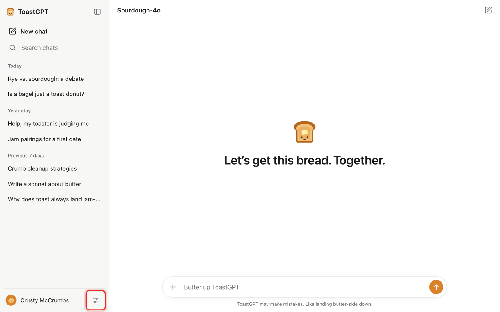

# FlopGPT user guides

FlopGPT looks like an AI chatbot, but every answer comes from a script that you write. Use it for skits, videos, classroom bits, pitches, or anything else where a "chatbot" needs to say exactly the right thing at exactly the right moment.

You don't need to know how to code. Everything below can be done by clicking around the app.

## What do you want to do?

| I want to…                                                   | Go to                                                                                                              |
| ------------------------------------------------------------ | ------------------------------------------------------------------------------------------------------------------ |
| Make the "AI" say exactly what I want                        | [Write your script](write-a-script.md)                                                                             |
| Make the "AI" look like it's thinking hard                   | [Write your script → Make it "think" before answering](write-a-script.md#make-it-think-before-answering)           |
| Fill the sidebar with fake past chats                        | [Write your script → Fill the sidebar with fake old chats](write-a-script.md#fill-the-sidebar-with-fake-old-chats) |
| Give the app my own name, logo, colors and jokes             | [Make it your own brand](make-it-your-brand.md)                                                                    |
| Try a finished example in 30 seconds                         | [Make it your own brand → Try the example brand](make-it-your-brand.md#try-the-example-brand-first)                |
| Perform a skit without fumbling the typing                   | [Run the show](run-the-show.md)                                                                                    |
| Start the skit over between takes                            | [Run the show → Start over](run-the-show.md#start-over-between-takes)                                              |
| Show it on phones (mine, my cast's or my audience's)         | [Put it on phones](share-to-phones.md)                                                                             |
| Install it on a phone's home screen like a real app          | [Put it on phones → Install it like a real app](share-to-phones.md#install-it-like-a-real-app)                     |
| Keep it working if the wifi drops mid-show                   | [Put it on phones → Keep working if the wifi drops](share-to-phones.md#keep-working-if-the-wifi-drops)             |
| Move my setup to another computer, or share it with a friend | [Make it your own brand → Save, share and back up](make-it-your-brand.md#save-share-and-back-up-your-setup)        |

## Which version should I use?

- **The desktop app** (Mac, Windows, Linux). Download it from the [Releases page](https://github.com/cocowmn/FlopGPT/releases/latest); the main [README](../README.md#download) says which file to pick. This is the only version that can [send the demo to phones](share-to-phones.md).
- **The browser version** at [flopgpt.vercel.app](https://flopgpt.vercel.app). Nothing to install. Your setup is saved in that browser only.

Both versions have the same settings, so every guide works in either one unless it says otherwise.

## The one button you need to know

Everything is changed in **Demo settings**. To open it, click the **sliders button** at the bottom of the sidebar, next to your user name. You can also press **⌘ ,** on a Mac or **Ctrl ,** on Windows and Linux.

If you don't see the sidebar, click the panel icon in the top-left corner first.
