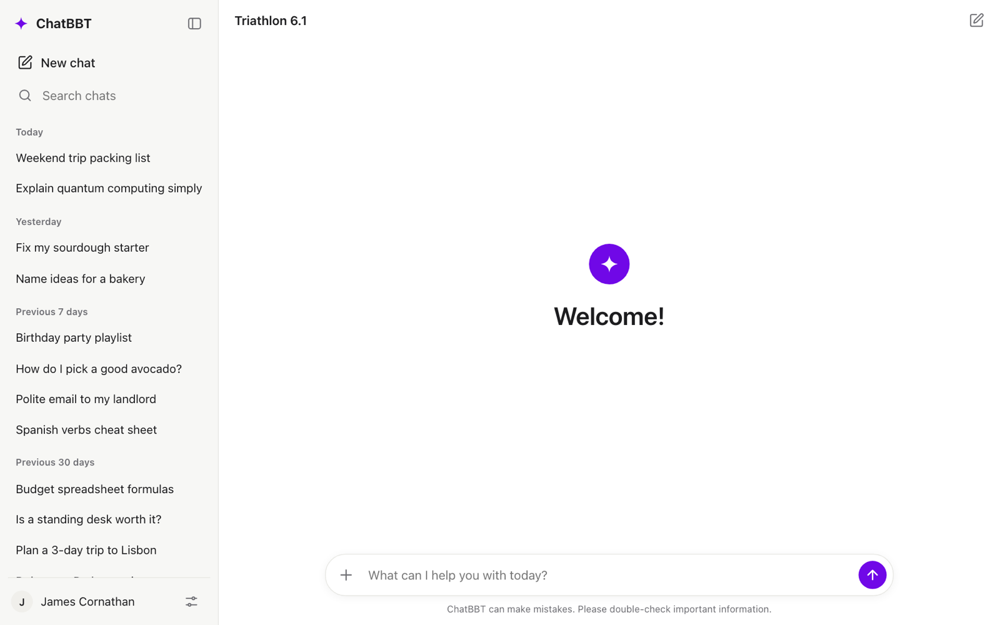
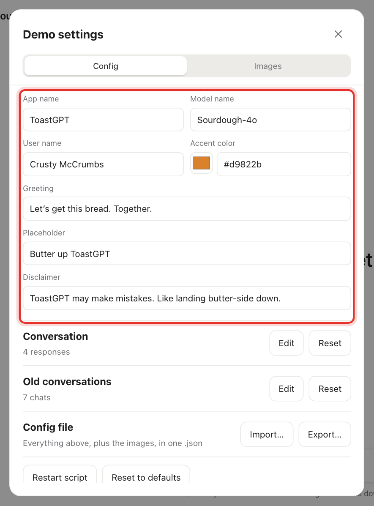
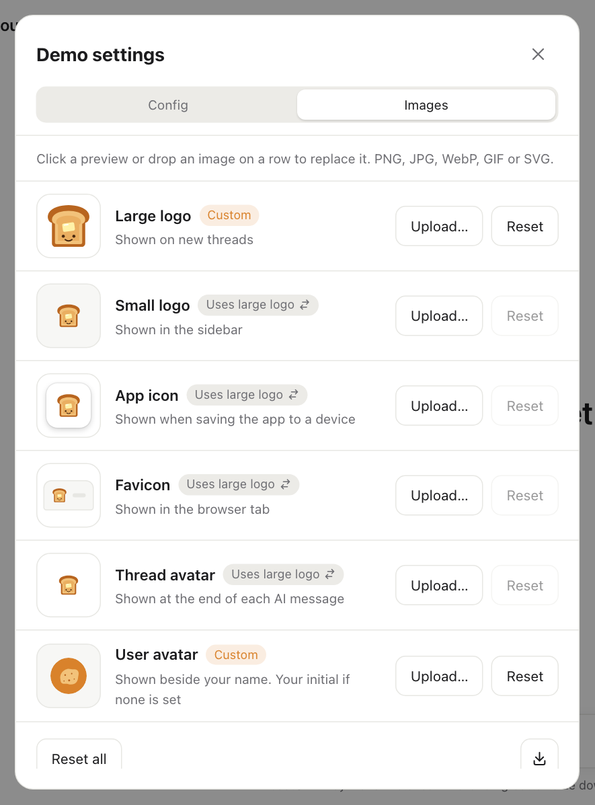

# Make it your own brand

**What you'll end up with:** an app with your product's name, logo, colors, slogan and fine print. Here's the built-in look, then the same app rebranded as **ToastGPT**, the example brand used in these guides:

| Before                                               | After                                                     |
| ---------------------------------------------------- | --------------------------------------------------------- |
|  |  |

Every change shows up as you type and is saved automatically. There's no Save button for branding.

## Try the example brand first

Want to see a finished brand before making your own?

1. Download [examples/toastgpt-config.json](examples/toastgpt-config.json). On GitHub, click the **Download raw file** button.
2. Drag the file onto the FlopGPT window. Or open **Demo settings > Config** and click **Import…**.

That's it: name, logo, colors, script and sidebar chats all change at once. To go back, click **Reset to defaults** at the bottom of the **Config** tab.

> **Tip:** export your own setup first (see [Save, share and back up](#save-share-and-back-up-your-setup)), because importing replaces it.

## Name it, and write its slogan and fine print

Open **Demo settings** (the sliders button at the bottom of the sidebar). The **Config** tab starts with your brand's text:

| Field            | Where it shows up                                 | ToastGPT example                                           |
| ---------------- | ------------------------------------------------- | ---------------------------------------------------------- |
| **App name**     | Top of the sidebar, browser tab, installed app    | ToastGPT                                                   |
| **Model name**   | Top of the chat (like "GPT-5")                    | Sourdough-4o                                               |
| **User name**    | Bottom of the sidebar (the "logged-in" person)    | Crusty McCrumbs                                            |
| **Accent color** | Send button, spinners, links, installed app color | `#d9822b` (toasted orange)                                 |
| **Greeting**     | Big headline on a new chat                        | Let's get this bread. Together.                            |
| **Placeholder**  | Faint text inside the empty message box           | Butter up ToastGPT                                         |
| **Disclaimer**   | Small print under the message box                 | ToastGPT may make mistakes. Like landing butter-side down. |

- **Accent color:** click the color square to pick a color, or paste a color code such as `#d9822b`.
- **Blank fields** fall back to the default shown in grey.

**Ideas for your fine print:** parody the real thing. Real chatbots warn that they "can make mistakes", so your version can say what kind of mistakes.

## Swap the logo everywhere at once

1. Open **Demo settings > Images**.
2. Click the **Large logo** preview, or click **Upload…**, and pick your image. You can also drag the image onto that row.

That one image is reused everywhere: the sidebar, the browser tab, the installed-app icon, and the little mark after each AI answer. Those rows say **Uses large logo** until you give them their own image.

**Getting a logo:**

- Use a square image with a transparent background (PNG or SVG) for the best results. PNG, JPG, WebP and GIF all work.
- No designer? An emoji works great. Search for a free emoji PNG, or screenshot one on a blank background and crop it square.
- The ToastGPT images are in [examples/toastgpt-images](examples/toastgpt-images/) if you want to see what works well.

## Use different images in different places

Each row on the **Images** tab is one spot in the app:

| Image             | Where it shows up                                                                   |
| ----------------- | ----------------------------------------------------------------------------------- |
| **Large logo**    | Above the greeting on a new chat                                                    |
| **Small logo**    | Next to the app name at the top of the sidebar                                      |
| **App icon**      | The home-screen icon when someone installs the app on a device                      |
| **Favicon**       | The browser tab                                                                     |
| **Thread avatar** | The small mark at the end of each AI answer                                         |
| **User avatar**   | Next to the user name in the sidebar. Without one, it shows the name's first letter |

- **Give a spot its own image:** click **Upload…** on that row.
- **Use the original FlopGPT image for one spot:** click its **Uses large logo ⇄** label. The label switches to **Uses default**.
- **Undo a spot:** click **Reset** on that row. **Reset all** at the bottom undoes every image.
- **Grab all your images at once:** click the download button in the bottom corner. It saves them as a .zip file.

## Make a skit-ready brand in 5 minutes (checklist)

1. **App name:** a parody of a real product.
2. **Model name:** a fake version number ("Sourdough-4o", "Burnt 3.5 Turbo").
3. **User name:** your main character.
4. **Greeting:** your slogan.
5. **Disclaimer:** your punchline.
6. **Accent color:** a color that matches your theme.
7. **Large logo**, plus a **User avatar** for your main character.
8. [Fill the sidebar with fake old chats](write-a-script.md#fill-the-sidebar-with-fake-old-chats) that set up the joke.
9. [Write the script](write-a-script.md).

## Save, share and back up your setup

Your whole setup is one small file: branding, images, script and sidebar chats.

- **Save it:** **Demo settings > Config > Export…** You'll get a file named something like `toastgpt-config.json`.
- **Load it** (on another computer, in another browser, or a friend's setup): drag the file onto the app, or click **Import…**.
- **Keep several brands:** export each one to its own file and import whichever you need for today's show. The app only holds one setup at a time.

Where it's saved:

- **Desktop app:** inside the app, and shared with any phones connected to it.
- **Browser version:** in that one browser only. Export before clearing your browser data or switching browsers.

## Stuck?

- **A row says "Couldn't load".** The image file is broken or unsupported. Try saving it again as PNG.
- **My logo looks tiny or squished.** Crop it to a square, with little empty space around it.
- **The phone home-screen icon still shows the old logo.** Once installed, phones keep the name and icon they were installed with. See [Put it on phones → Brand it before you install it](share-to-phones.md#brand-it-before-you-install-it).
- **I can't type in the fields on my phone.** The desktop app has phone editing turned off. Turn on **Let phones change the config** in the desktop app's **Server** tab, or make the changes on the computer instead.
