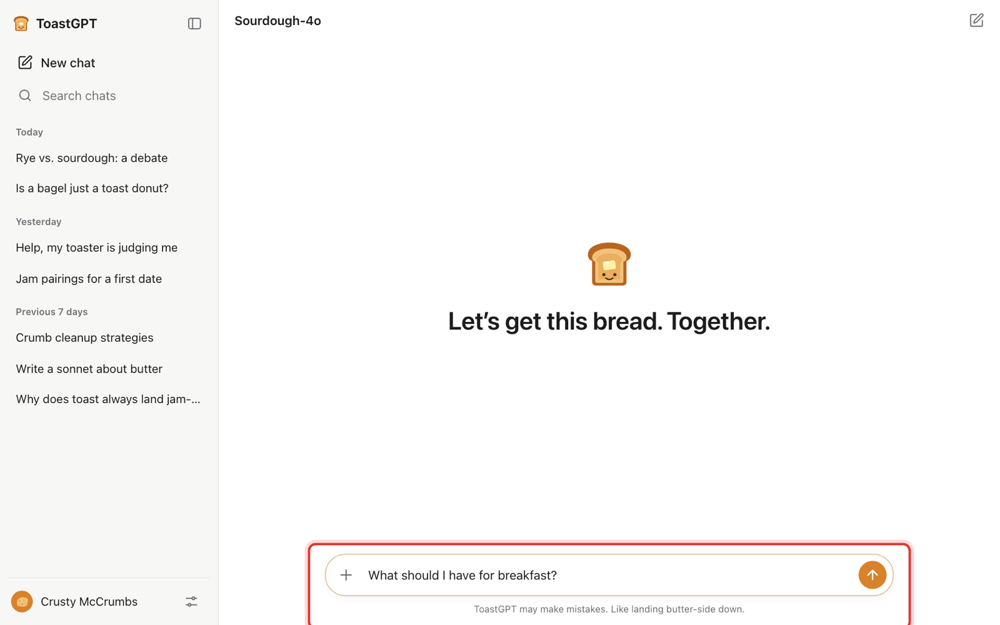
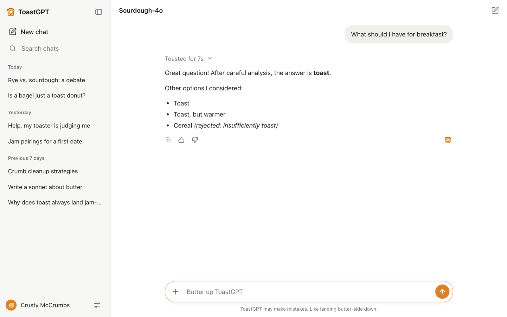

# Run the show

**What you'll end up with:** a smooth performance. Every line types out perfectly on cue, with no fumbled typing on camera, and a reset for the next take is one click away.

## Perform with perfect typing

If your script's responses have a **Prompt** ([how to add one](write-a-script.md#make-the-prompt-type-itself)), FlopGPT can type each line for you:

1. Click into the empty message box.
2. Press **Tab**. On a phone, **press and hold** the empty message box for about half a second. The next prompt types itself out, letter by letter, like a real person typing.

   

3. Press **Enter**, or tap the send button, to send it.

**Shortcut:** pressing **Enter** with the box still empty sends the next prompt instantly, with no typing animation. This is handy for rehearsals.

You can also just type whatever you like and send it. The next scripted response plays no matter what was typed.

## What the audience sees

After you send, the thinking steps play one by one with a spinner, and then the answer types out:

The thinking steps then fold into a line like "Toasted for 7s". Click it to show the steps again. This makes a great close-up shot for a video.

## Start over between takes

Any of these restarts the script from the first response:

- **New chat** in the sidebar.
- The **pen-and-square icon** in the top-right corner.
- **Demo settings > Config > Restart script**.

## Rehearsal tips

- **Do a full run-through first.** The script plays in order, so a skipped line means every answer after it is off by one. If that happens, click **New chat** and start again.
- **Hide the sidebar** with the panel icon in the top-left, for a cleaner frame.
- **Recording on a phone?** Set your phone to Do Not Disturb, and [load the demo on the phone](share-to-phones.md) so you can film the real screen.
- **Use attachments as props.** The **+** button attaches photos, videos, audio, PDFs or text files to a message, and you can also drop or paste files in. The answer is still the next scripted one, but the attachment shows up in the chat. Attachments never leave the device.
- **Dark mode** follows your computer or phone's setting.

## Stuck?

- **Tab didn't type anything.** The message box must be empty, and the next response must have a **Prompt**. After the last response there's nothing left to type, so click **New chat**.
- **Long-press opened the phone's copy/paste menu instead.** Press and hold without moving your finger, on the empty box.
- **The answers are out of order.** A message was sent twice or a line was skipped. Click **New chat** and start from the top.
- **I changed the script but the old one is still playing.** On a connected phone, changes wait until the current chat ends, so the show isn't interrupted. A note says "Config updated. It loads at the next New chat." Tap **New chat**.
