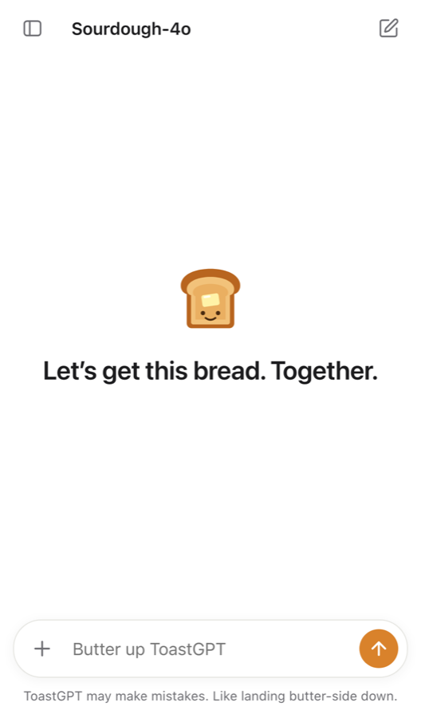
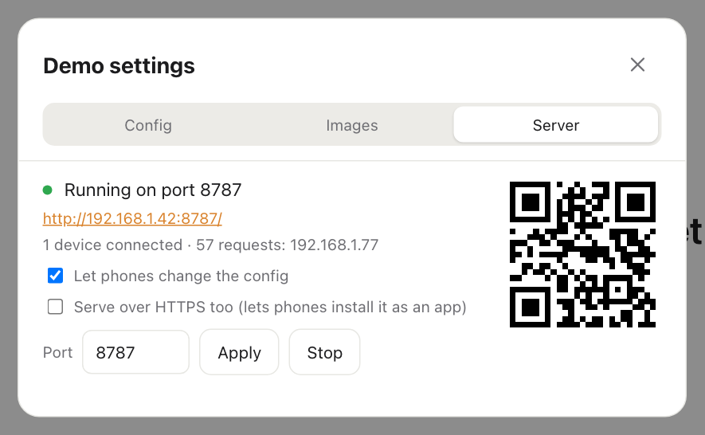
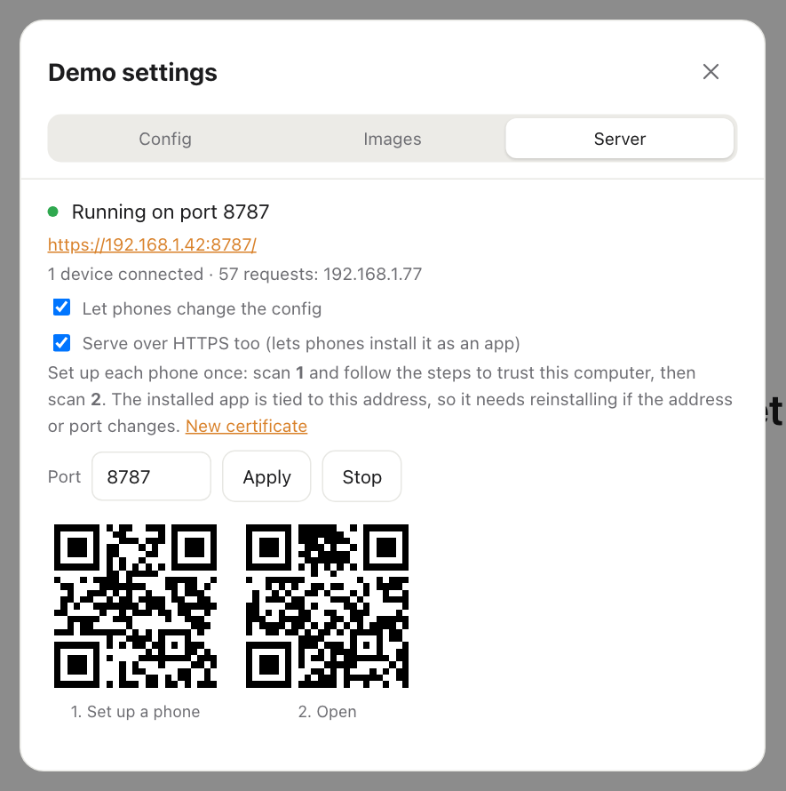
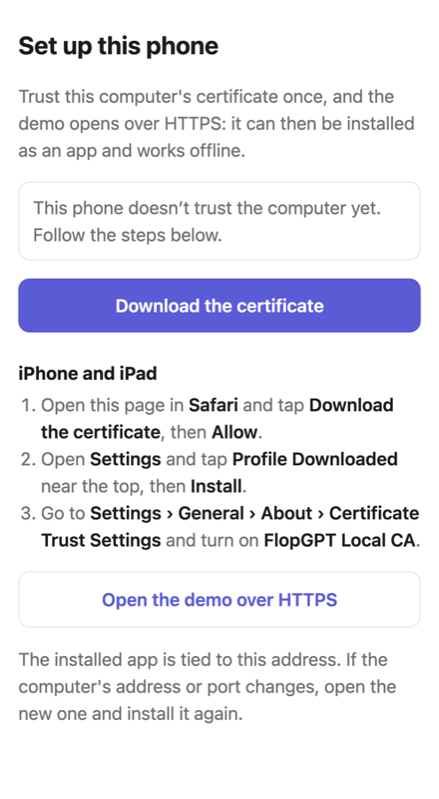

# Put it on phones

**What you'll end up with:** your branded demo running on phones. It can open in the phone's browser, or be installed on the home screen like a real app. When you change the script on your computer, the phones pick up the change.

## Pick your route

| You want…                                                               | Use                                                                              |
| ----------------------------------------------------------------------- | -------------------------------------------------------------------------------- |
| One phone, no computer involved                                         | [The browser version](#one-phone-no-computer-use-the-browser-version)            |
| Several phones showing the same demo, all controlled from your computer | [The desktop app's phone server](#get-it-on-a-phone-in-2-minutes)                |
| …and installed on the home screen, still working if the wifi drops      | The phone server, plus [Install it like a real app](#install-it-like-a-real-app) |

## One phone, no computer: use the browser version

1. On the phone, open [flopgpt.vercel.app](https://flopgpt.vercel.app).
2. Install it on the home screen:
   - **iPhone (Safari):** tap the **Share** button, then **Add to Home Screen**.
   - **Android (Chrome):** tap the **⋮** menu, then **Install app** or **Add to Home screen**.
3. Open it from the home screen and set it up there, following [Make it your own brand](make-it-your-brand.md). Or **Import…** a config file you exported on your computer.

> On iPhone, the home-screen app has its own storage, separate from Safari. Set it up _inside the installed app_, not in Safari.

## Get it on a phone in 2 minutes

This needs the **desktop app** running on a computer, with the phone **on the same wifi**.

1. Open the desktop app, then open **Demo settings > Server**. The server starts by itself when the app opens, so you should see **Running on port 8787**.

   

2. Point the phone's camera at the QR code and tap the link that appears. Or type the address shown, such as `http://192.168.1.42:8787/`, into the phone's browser.
3. The demo opens on the phone, with the same brand and script as your computer.

**Good to know:**

- **Every phone follows your computer.** Change the script or brand on the computer, and connected phones update. A phone in the middle of a chat waits for its next **New chat**, so a live take isn't interrupted.
- **Counting connections:** the panel shows how many devices are connected. Use it to confirm the phone actually reached your computer.
- **Mac permission:** if your Mac asks whether FlopGPT may "accept incoming network connections", click **Allow**. On Windows, allow access when the firewall asks.

## Decide who can change the demo

**Let phones change the config** is on by default. With it on, anyone with the demo open on the same wifi can edit the script and branding, and the changes save to your computer.

- **Home, or a rehearsal with your own cast:** leave it on. It's handy for tweaking lines from your phone.
- **Shared or public wifi, or a show with an audience:** turn it **off**. Phones can then still view the demo but not change it.

## Install it like a real app

Phones only let a web page install as a full app (with offline mode) when the page uses a secure connection, called **HTTPS**. FlopGPT can make its own HTTPS certificate, a small file that proves to the phone it's talking to your computer. Each phone needs to trust that certificate once.

### On the computer (once)

1. In **Demo settings > Server**, check **Serve over HTTPS too**.
2. Two QR codes appear: **1. Set up a phone** and **2. Open**.

   

### On each phone (once)

1. Scan QR code **1**. A setup page opens that shows the steps for that phone:

   

2. Tap **Download the certificate**, then follow the steps for your phone:
   - **iPhone/iPad** (you must use **Safari**):
     1. Tap **Allow**.
     2. Open **Settings** and tap **Profile Downloaded** near the top, then **Install**.
     3. Go to **Settings › General › About › Certificate Trust Settings** and turn on **FlopGPT Local CA**.
   - **Android:** open **Settings › Security › More security settings › Encryption & credentials › Install a certificate › CA certificate**, and pick **FlopGPT-CA.crt**. If the menus are named differently on your phone, search Settings for "CA certificate".
3. Go back to the setup page. It should now say **✓ This phone trusts the computer**.
4. Scan QR code **2**, or tap **Open the demo over HTTPS**.
5. Install it:
   - **iPhone:** tap **Share**, then **Add to Home Screen**.
   - **Android (Chrome):** tap **⋮**, then **Install app**.

The home-screen icon now opens your demo full-screen, with no browser bars, just like a real app.

### Is that certificate safe?

Yes. The certificate only works for addresses on your home or local network (like `192.168.x.x`), so it can't be used to pretend to be any real website. To remove it later:

- **iPhone:** **Settings › General › VPN & Device Management**, then delete the FlopGPT profile.
- **Android:** **Settings › Encryption & credentials › User credentials**.

## Brand it before you install it

Phones grab the **name** and **icon** at the moment you install, and then keep them:

- **iPhone** never updates them.
- **Android** may update them on its own, but it can take a day.

So [finish your branding](make-it-your-brand.md) first, then install. To change the name or icon afterwards, delete the home-screen app and install it again.

(The accent color, script and everything else update right away, even after installing.)

## Keep working if the wifi drops

The installed HTTPS app keeps a copy of the last setup it received. If the phone loses touch with your computer during a show, the demo still opens and plays.

- If the phone has never connected over HTTPS, it shows **"Can't reach the FlopGPT app. Check it's running and on the same wifi."** Make sure it's connected at least once before showtime.
- When the connection comes back, it picks up any changes you made.

## Keep the same address between shows

The installed app is tied to the exact address it was installed from, such as `https://192.168.1.42:8787/`. If your computer gets a different address next time (which often happens after a restart or on a new network), the old home-screen app can't find it.

- **Easiest fix:** reinstall from the new address. You don't need to redo the certificate on the same computer.
- **Permanent fix:** in your wifi router's settings, give your computer a fixed address. This is often called "reserved IP" or "DHCP reservation". If the router isn't yours, ask whoever runs the network.
- **Changing the port:** type a new number in **Port** and click **Apply**. This also changes the address, so phones need to reinstall.

## Stuck?

- **The phone can't open the address.**
  - Check that the phone and the computer are on the _same_ wifi. Guest networks and some office or school networks block this.
  - On a Mac, make sure FlopGPT was allowed to accept incoming connections: **System Settings › Network › Firewall › Options**.
- **"No wifi network found."** The computer isn't connected to a network. Join the wifi and look again.
- **The setup page still says the phone doesn't trust the computer.**
  - **iPhone:** the last step, turning on **FlopGPT Local CA** in **Certificate Trust Settings**, is the one people miss.
  - **Android:** make sure you installed it as a **CA certificate**.
- **It worked yesterday and now it doesn't.** Your computer's address probably changed. Check the address in the **Server** tab, then see [Keep the same address between shows](#keep-the-same-address-between-shows).
- **I clicked "New certificate".** That replaces the certificate, so every phone has to repeat the [phone steps](#on-each-phone-once).
