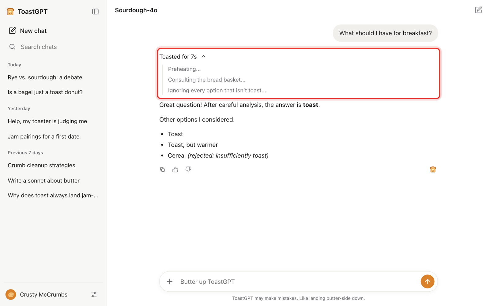
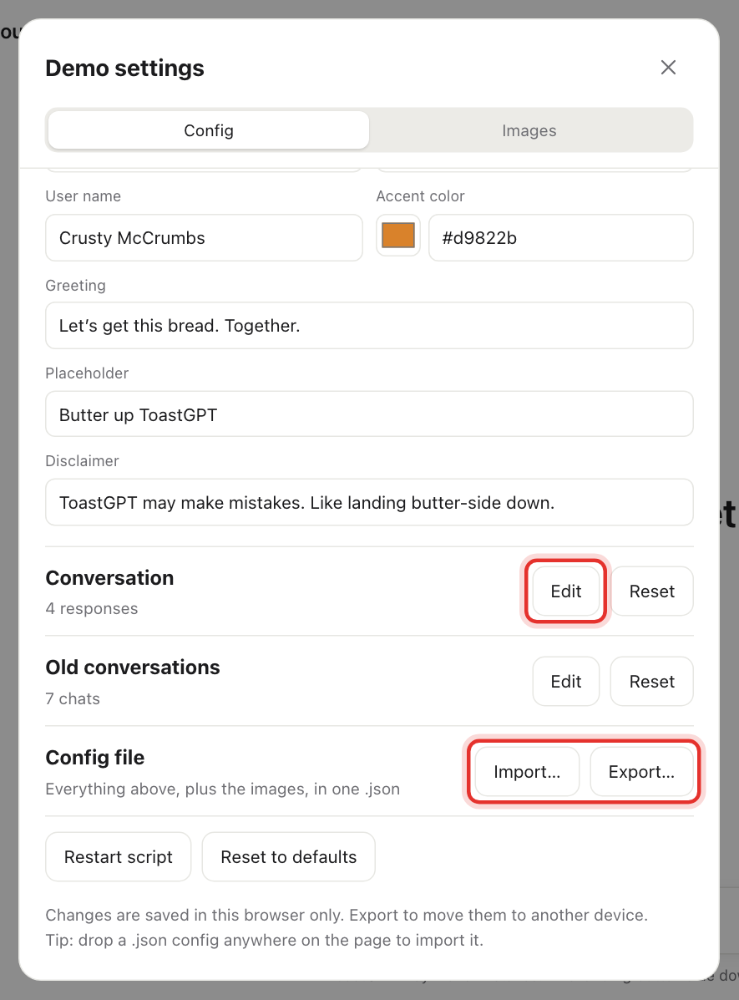
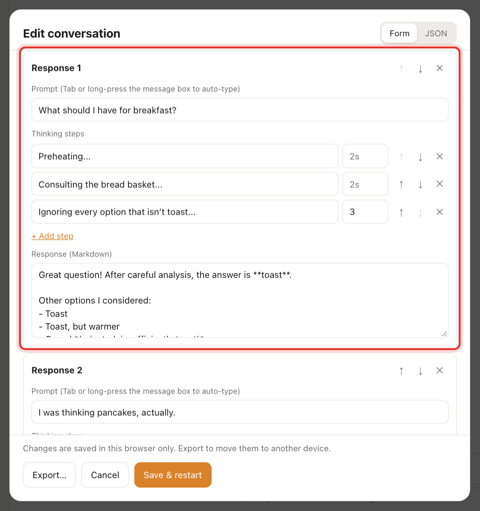
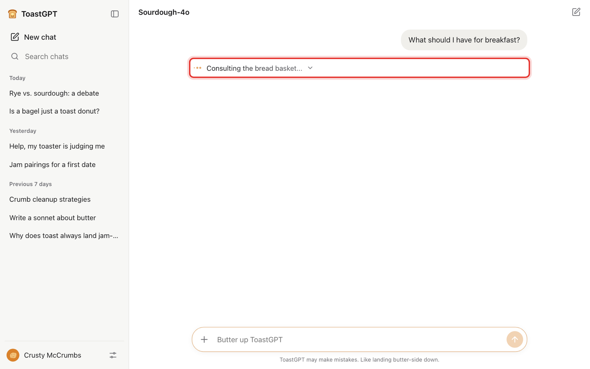
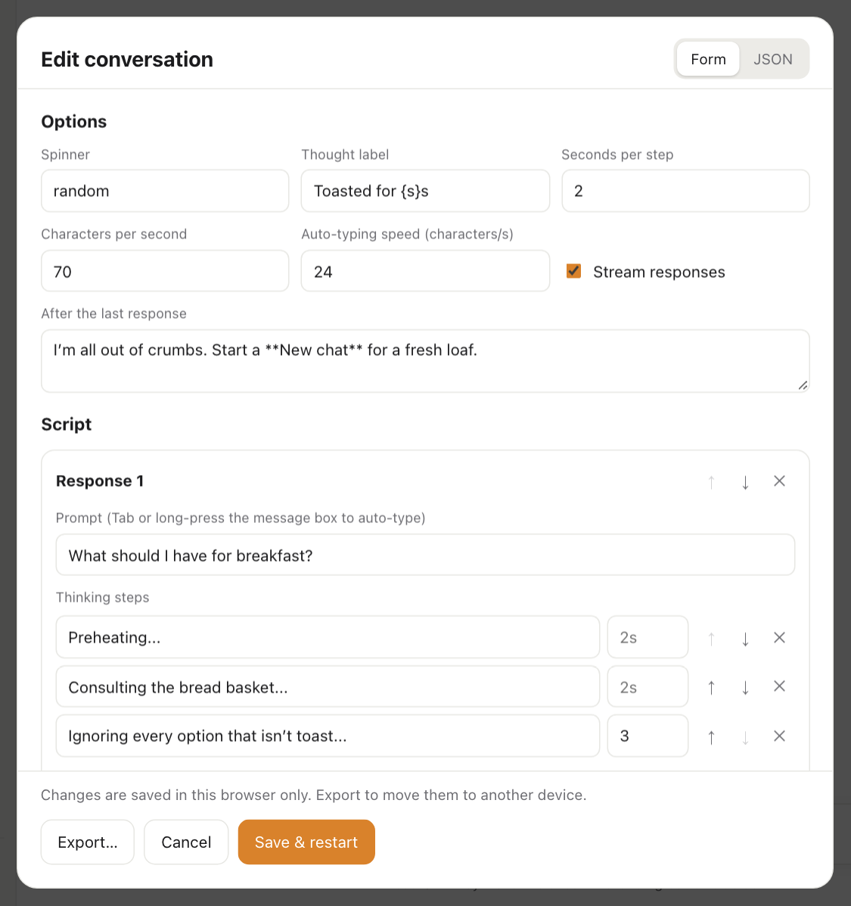
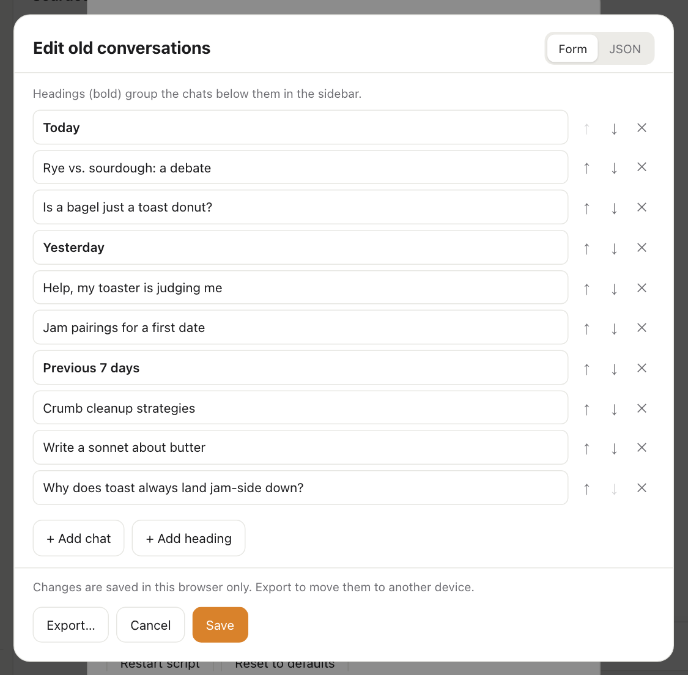
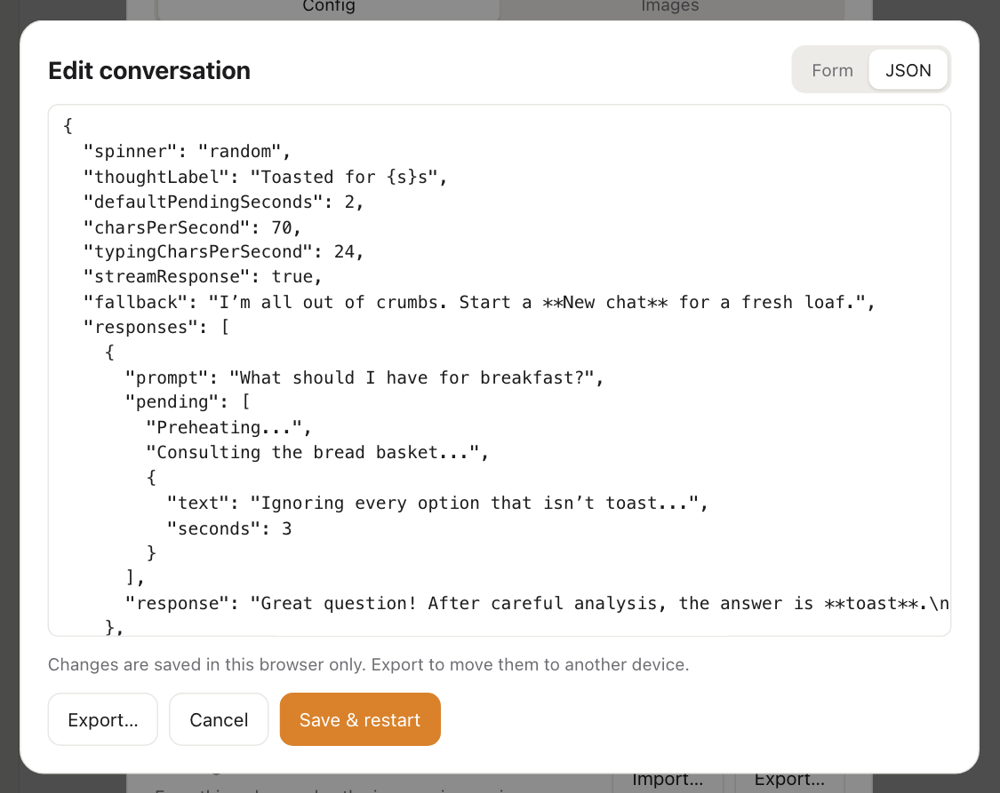

# Write your script

**What you'll end up with:** a chatbot that answers with your lines, in your order, with as much fake "thinking" as the joke needs.



## How a script works (30-second version)

- A script is a list of **responses**. Each time someone sends a message, the next response plays, whatever they typed.
- Each response has up to three parts:
  - **Prompt** (optional): the line your performer "types". FlopGPT can type it for them (see [Run the show](run-the-show.md)).
  - **Thinking steps:** short lines like "Thinking…" that flash by before the answer.
  - **Response:** the answer itself.
- Once all the responses have played, every message gets the **After the last response** message, until you start a new chat.

## Change what the AI says back

1. Open **Demo settings** (the sliders button at the bottom of the sidebar).
2. On the **Config** tab, next to **Conversation**, click **Edit**.

   

3. Scroll down to **Script**. Each card is one response, in the order they'll play.

   

4. Type the answer into **Response (Markdown)**.
5. Click **Save & restart**. The chat starts over with your new script.

**Card buttons:**

- **+ Add response** (below the last card) adds a new card to the end.
- **↑** and **↓** move a card earlier or later.
- **✕** deletes a card.

## Make it "think" before answering

The thinking steps are where a lot of the comedy lives ("Thinking of a believable lie…").

1. In a response card, type a line into a **Thinking step** box.
2. Click **+ Add step** for each extra line. They show one after another, in order.
3. Optional: type a number of seconds in the small box next to a step to keep it on screen longer or shorter. Leave the box blank to use the default.

While the steps play, they look like this:



When the answer arrives, the steps fold up into a line like "Thought for 7s", which anyone can click to read them all again.

**Tips:**

- **Comic timing:** give a short step (1–1.5 s) right before a long one (3–4 s). The pause sells the punchline.
- **Answer instantly:** delete all the thinking steps from that card.

## Make the prompt type itself

Fill in a card's **Prompt** box with the exact line your performer is supposed to say. During the show, pressing **Tab**, or long-pressing the message box on a phone, makes it type itself out letter by letter. [Run the show](run-the-show.md) explains how to perform with it.

You can leave **Prompt** empty if the performer will type their own words. The response plays either way.

## Make text bold, add lists, and more

Responses support **Markdown**, a few simple symbols that format text:

| Type this                  | To get            |
| -------------------------- | ----------------- |
| `**toast**`                | **toast**         |
| `*toast*`                  | _toast_           |
| `- Toast` on its own line  | a bullet point    |
| `1. Toast` on its own line | a numbered list   |
| `> Toast.`                 | an indented quote |
| `# Toast`                  | a big heading     |
| `[link](https://…)`        | a clickable link  |
| `` `toast` ``              | `code-style` text |

Leave an empty line between paragraphs. Emoji work too 🍞.

## Change the speed and the "thinking" style

The **Options** section at the top of the editor applies to the whole script:



| Option                               | What it does                                                                                                             |
| ------------------------------------ | ------------------------------------------------------------------------------------------------------------------------ |
| **Spinner**                          | The little animation beside the thinking steps. Leave blank for a random one each time, or type `none` for no animation. |
| **Thought label**                    | What the steps fold up into. `{s}` becomes the number of seconds, as in `Toasted for {s}s`.                              |
| **Seconds per step**                 | How long each thinking step shows, unless the step has its own number (2.5 s if left blank).                             |
| **Characters per second**            | How fast the answer types out on screen. Lower is more dramatic.                                                         |
| **Auto-typing speed (characters/s)** | How fast the **Prompt** types itself when you press Tab.                                                                 |
| **Stream responses**                 | On: the answer types out word by word. Off: it appears all at once.                                                      |
| **After the last response**          | What the AI says to every message once the script has run out.                                                           |

## Fill the sidebar with fake old chats

The sidebar's chat history is fake too. It's another chance for jokes ("Help, my toaster is judging me").

1. In **Demo settings > Config**, click **Edit** next to **Old conversations**.
2. Type chat titles into the boxes. **+ Add chat** adds another one.
3. **+ Add heading** adds a bold group label such as "Today" or "Yesterday". It sits above the chats that come after it.
4. Click **Save**.



These chats are just for show: clicking one only highlights it.

## Write it as text instead (optional power move)

If you'd rather write the whole script in a text editor, or copy and paste one from a friend, click the **JSON** tab at the top of the editor. JSON is a plain-text way of writing the same script.



The shape is simple. Each `{ … }` block in `responses` is one card:

```json
{
  "responses": [
    {
      "prompt": "What should I have for breakfast?",
      "pending": ["Preheating...", { "text": "Ignoring every option that isn't toast...", "seconds": 3 }],
      "response": "Great question! The answer is **toast**."
    },
    {
      "prompt": "Are you biased?",
      "pending": ["No", "Absolutely not", "Well..."],
      "response": "I am a perfectly neutral assistant."
    }
  ],
  "fallback": "I'm all out of crumbs. Start a **New chat** for a fresh loaf."
}
```

- `pending` is the list of thinking steps. A step is either plain text in quotes, or `{ "text": "...", "seconds": 3 }` to set its own time.
- Put commas between items, but not after the last one. If something's wrong, the editor shows an error in red instead of saving.
- Switch back to the **Form** tab at any time; your changes carry over.

A full example is in [examples/toastgpt-config.json](examples/toastgpt-config.json).

## Stuck?

- **My new script didn't play.** Make sure you clicked **Save & restart**, not **Cancel**. If you're mid-chat on a phone, the change waits for the next **New chat**.
- **It keeps saying the same thing.** You've reached the end of the script, so it's showing the **After the last response** message. Click **New chat** to start over.
- **I broke everything.** Click **Reset** next to **Conversation** to go back to the built-in script. To undo everything (branding included), click **Reset to defaults**.
- **Next:** [make it look like your own product](make-it-your-brand.md), or [learn to perform it](run-the-show.md).
